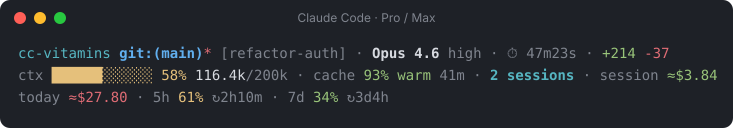
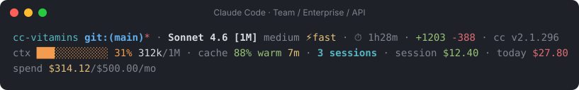

<div align="center">

# cc-vitamins

**A two-line status line for Claude Code: where you are, and what it costs.**

Context, prompt cache, usage limits, spend and open sessions at a glance.
Works on every plan. Pure `/bin/sh` + `jq`, installs in one command.

[](https://github.com/andriitk/cc-vitamins/actions/workflows/ci.yml)


[](LICENSE)





</div>

```sh
curl -fsSL https://raw.githubusercontent.com/andriitk/cc-vitamins/main/install.sh | sh
```

> Unofficial community project, not affiliated with Anthropic.

---

## Why

The default Claude Code footer tells you little about the two things that
actually bite during a long session: **how full the context is** and **how
close you are to a limit**. cc-vitamins puts both in front of you, colored
green → yellow → orange → red as they climb, and adapts to your plan:

- **Pro / Max**: your 5-hour and 7-day usage windows with a countdown to the
  reset (`5h 61% ↻2h10m`), so you know whether to push on or wait.
- **Team / Enterprise / API**: what the session and the day cost, and your
  spend limit if your organization sets one through a Claude apps gateway.
- **Everyone**: context fill and the change per turn, prompt-cache hit ratio
  and minutes until a warm cache goes cold, git state, model, effort, and how
  many Claude Code sessions are open right now.

Segments that your plan does not provide are simply not shown: no errors, no
placeholders.

---

## Works with every plan

Claude Code sends the status line a JSON object, and some fields exist only on
some plans ([official field reference](https://code.claude.com/docs/en/statusline#available-data)).
cc-vitamins reads each one only when it is there.

| | Pro / Max | Team / Enterprise | API key, Bedrock, Vertex |
|---|:-:|:-:|:-:|
| Context bar, tokens, per-turn delta | ✓ | ✓ | ✓ |
| Prompt cache: hit ratio, warm/cold, expiry | ✓ | ✓ | ✓ |
| Git, worktree, model, effort, fast mode, duration, +/- lines, Claude Code version | ✓ | ✓ | ✓ |
| Open sessions count | ✓ | ✓ | ✓ |
| `session $` / `today $` | ≈ API-equivalent | ✓ estimate | ✓ estimate |
| 5h / 7d usage with reset countdown | ✓ | — | — |
| Spend limit (`spend $314/$500/mo`) | — | ✓ ¹ | ✓ ¹ |

¹ Only behind a [Claude apps gateway with spend limits](https://code.claude.com/docs/en/claude-apps-gateway-spend-limits).
Until the dollar figures arrive it shows the percentage, `spend 63%`.

**What the dollar figures mean.** Claude Code computes `cost.total_cost_usd`
on your machine at API list price. On a usage-billed plan (API, most
Enterprise setups) that tracks your bill closely. On Pro and Max you pay a flat
subscription, so the figure is what the same work *would* cost on the API:
handy for seeing how heavy a session is, but not money you are charged.
cc-vitamins recognizes a subscription by the 5h/7d windows and prefixes the
figures with `≈` there (`session ≈$3.84`). On Pro and Max, the numbers to
watch are `5h` and `7d`.

---

## Install

**Requirements:** macOS or Linux (on Windows, use WSL), `jq`, and `git`
(the one-liner clones the repo into a temp dir).
Optional: [`ccusage`](https://github.com/ryoppippi/ccusage) for the
"today across all sessions" segment. The prompt-cache and spend-limit segments
need Claude Code v2.1.251 or later; older versions just don't show them.

```sh
brew install jq          # macOS
sudo apt install jq      # Debian / Ubuntu
```

**One-liner:**

```sh
curl -fsSL https://raw.githubusercontent.com/andriitk/cc-vitamins/main/install.sh | sh
```

**From a checkout** (read the code first, then run it):

```sh
git clone https://github.com/andriitk/cc-vitamins.git
cd cc-vitamins && ./install.sh
```

Then open a new Claude Code session. The installer:

- copies cc-vitamins into `~/.claude/cc-vitamins` (or `$CLAUDE_CONFIG_DIR/cc-vitamins`);
- backs up `settings.json` with a timestamp and sets `statusLine`, keeping every
  other key;
- sets `refreshInterval: 60` so the countdowns stay current while you are idle;
- if you already have a different status line, asks before replacing it, and
  leaves it alone when there is no terminal to ask in. `--force` replaces it.

**Update:** run the same one-liner again. **Uninstall** (restores the status
line you had before the very first install and removes the files):

```sh
curl -fsSL https://raw.githubusercontent.com/andriitk/cc-vitamins/main/install.sh | sh -s -- --uninstall
```

Other flags work the same way after `sh -s --`, or directly on `./install.sh`
in a checkout: `--dry-run` shows what would change, `--force` replaces an
existing status line without asking.

<details>
<summary>Manual install</summary>

Clone the repo anywhere and point `statusLine` at the entry point in
`~/.claude/settings.json`. Keep `bin/` and `lib/` together.

```json
{
  "statusLine": {
    "type": "command",
    "command": "/absolute/path/to/cc-vitamins/bin/cc-vitamins",
    "padding": 0,
    "refreshInterval": 60
  }
}
```

</details>

### Optional: today across all sessions

The `today $` segment sums the cost of every session today. It comes from
[ccusage](https://github.com/ryoppippi/ccusage), which reads Claude Code's
local logs:

```sh
npm i -g ccusage
```

If you would rather not install it globally, set `CC_VITAMINS_CCUSAGE=npx` in
the config to run `npx ccusage@latest` instead. That downloads code from npm,
so it is opt-in. Either way the call runs in the background behind a cache,
and the status line never waits for it.

---

## What you see

**Line 1: where am I**

| Segment | Example | Notes |
|---|---|---|
| Vim mode | `[N]` / `[I]` | Only with vim mode on. |
| Directory | `my-app` | Basename of the current directory. |
| Git | `git:(main)*` | Branch; red `*` when the tree is dirty. |
| Worktree | `wt:(feature:wip)` | During a worktree session. |
| Agent | `agent:(reviewer)` | When running with `--agent`. |
| Session | `[refactor-auth]` | Session name, once it has one. |
| Model, effort, fast | `Opus 4.6 high ⚡fast` | Effort only for models that support it. |
| Duration | `⏱ 47m23s` | Wall-clock session time. |
| Lines | `+214 -37` | Lines added / removed. |
| Version | `cc v2.1.296` | Claude Code version, dim. |

**Line 2: what it costs**

| Segment | Example | Notes |
|---|---|---|
| Context | `ctx ██████░░░░░░ 58% 116.4k/200k ▲+4.2k` | Fill, tokens / window, change since the previous turn. 1M windows are colored by absolute tokens. |
| Prompt cache | `cache 93% warm 41m` | Hit ratio, state, minutes until a warm cache expires (yellow under 10 min). |
| Sessions | `2 sessions` | Claude Code sessions open right now. |
| Session cost | `session $1.84 (all-time $6.20)` | This session today; all-time when it started on an earlier day. |
| Today | `today $27.80` | All sessions today, via ccusage. |
| Spend limit | `spend $314.12/$500.00/mo` | Gateway spend limit and its period. |
| Rate limits | `5h 61% ↻2h10m · 7d 34% ↻3d4h` | Pro / Max usage windows and time to reset. |

Rows wrap between segments to fit the terminal width (Claude Code passes it in
`COLUMNS`), so a segment is never cut in half on a narrow window.

---

## Configuration

Everything works out of the box. To customize, copy the example config:

```sh
mkdir -p "${XDG_CONFIG_HOME:-$HOME/.config}/cc-vitamins"
cp ~/.claude/cc-vitamins/config.example "${XDG_CONFIG_HOME:-$HOME/.config}/cc-vitamins/config"
```

Every option is documented in [`config.example`](config.example). Any of them
can also be set as an environment variable, which wins over the file.

- **Segments and order**: `CC_VITAMINS_LINE1`, `CC_VITAMINS_LINE2`. Remove a
  word to hide a segment, reorder words to reorder the line. For example, a
  Max user who does not care about dollars:
  `CC_VITAMINS_LINE2="context cache sessions ratelimits"`.
- **Thresholds**: context percent and token thresholds, `today $` yellow and
  red cutoffs, rate-limit percentages, cache-expiry warning.
- **Reset countdown**: `CC_VITAMINS_RESET_COUNTDOWN=0` hides `↻2h10m`.
- **Colors**: `NO_COLOR=1` for plain text.

---

## How it works

- **One `jq` pass.** stdin is parsed by a single `jq` call that emits
  shell-quoted (`@sh`) assignments, not one subprocess per field.
- **Never blocks.** `ccusage` runs in the background under a lock with a
  stale-while-revalidate cache; the status line renders the cached value.
- **Session count.** Each render writes a heartbeat file holding the PID of
  the Claude Code process that owns it; the count is the heartbeats whose PID
  is still alive. If Claude Code runs the command through a short-lived shell,
  cc-vitamins records that shell's parent instead.
- **Small state.** Per-turn context deltas and per-day session baselines live
  in `${XDG_CACHE_HOME:-~/.cache}/cc-vitamins` and are pruned after 14 days.
- **Portable.** POSIX `sh`, BSD and GNU `date`/`stat`/`awk`, locale-independent
  number formatting, shellcheck-clean, tested on macOS and Ubuntu in CI.

---

## Troubleshooting

- **The status line says `jq not found`.** Install `jq`, then start a new session.
- **No `5h` / `7d`.** They are sent only on Pro / Max, and only after the first
  response in a session.
- **No `today $`.** Install `ccusage`, or set `CC_VITAMINS_CCUSAGE=npx`.
- **Nothing changed after install.** You already had a different status line
  and the installer left it alone. Re-run with `--force`.
- **Colors look wrong.** Set `NO_COLOR=1`.

---

## Contributing

Issues and PRs are welcome. Before opening a PR:

```sh
make check    # shellcheck + the test suite
```

Keep the code POSIX `sh` (no bashisms), shellcheck-clean, and add a fixture
test for new behavior.

Changes land on `main` through pull requests with green CI. A release is a PR
that bumps `VERSION` and adds its `CHANGELOG.md` section; merging it tags and
publishes the release automatically. Security issues: see
[SECURITY.md](SECURITY.md).

## License

MIT © 2026 Andrii Tkachuk. See [LICENSE](LICENSE).
